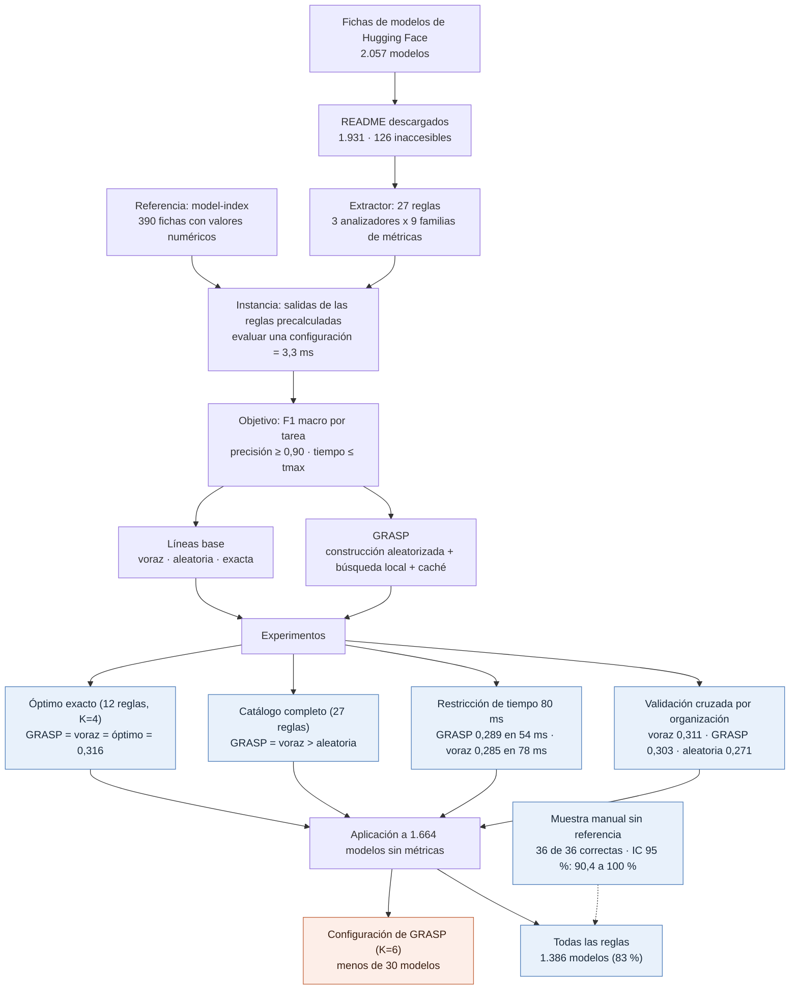

# Optimización metaheurística de la extracción de métricas en fichas de modelos

Proyecto final del curso de Metaheurística (Maestría en Ingeniería, Universidad de Antioquia). Optimiza la configuración de la etapa de extracción de métricas de desempeño de un ETL sobre fichas de modelos (*model cards*) de Hugging Face: qué reglas de un catálogo activar, en qué orden de prioridad y con qué umbral de validación. El objetivo es el $F_1$ macro por tarea, con a lo sumo $K$ reglas, precisión mínima de 0,90 y un tiempo máximo por ficha.

El repositorio implementa un GRASP con búsqueda local y memoria de evaluaciones, lo compara con un voraz, una búsqueda aleatoria y la enumeración exacta, y aplica el resultado a los modelos del ETL que no tienen métricas. El algoritmo genético y la prueba estadística son la Entrega 4. El ETL que produce los datos está en [`jufegare000/huggingface-etl-co2emissions`](https://github.com/jufegare000/huggingface-etl-co2emissions).

## Metodología y resultados



## Resultados principales

| Experimento | Resultado |
|---|---|
| Óptimo exacto (12 reglas, K=4) | GRASP y el voraz alcanzan el óptimo, 0,316; la búsqueda aleatoria, 0,294 |
| Catálogo completo, K=5 y K=6 | GRASP iguala al voraz (0,340 y 0,357) y supera a la aleatoria (0,286 y 0,320) |
| Restricción de tiempo | Todas las soluciones son factibles; GRASP usa menos tiempo a 80 ms |
| Validación cruzada por organización | Sin diferencia distinguible entre GRASP y el voraz (desviación entre pliegues ≈ 0,14) |
| Aplicación al ETL | La configuración optimizada no se transfiere: recupera menos de 30 modelos, mientras que todas las reglas recuperan 1.386 |

La configuración de GRASP se ajustó sobre una referencia de similitud de oraciones y extracción de características, y con K=6 queda sin las reglas que usa el formato AutoTrain, que domina la población sin métricas. Por eso la función objetivo debe incluir esa población (Entrega 4).

## Estructura

```
src/metric_extraction/
  download.py     descarga resumible de README
  evidence.py     analizadores de texto (línea, fila y columna de tabla)
  gold.py         normalización de nombres y comparación con la referencia
  rules.py        catálogo de 27 reglas
  evaluator.py    Instance: salidas precalculadas y evaluación de configuraciones
  baselines.py    Objective (aptitud, restricciones, caché) y líneas base
  grasp.py        GRASP con búsqueda local
  apply.py        aplicación de una configuración a modelos sin métricas
  genetic.py      algoritmo genético (pendiente, Entrega 4)
notebooks/
  01_factibilidad.ipynb   ¿está la información en el cuerpo del README?
  02_aplicacion.ipynb     configuraciones, aplicación y métricas
docs/             entregas del curso (formato IEEE)
results/          configuraciones, tablas y figuras
data/             datos (no versionados)
```

## Cómo reproducir

```bash
python3 -m venv .venv && source .venv/bin/activate
pip install -e . jupyterlab ipykernel matplotlib pytest
python -m ipykernel install --user --name metaheuristic --display-name "Python (metaheuristic)"
cp .env.example .env        # y completa HF_TOKEN
```

Coloca `HFCO2_2026.csv` (la exportación del ETL) en `data/` y ejecuta los notebooks en orden: `01_factibilidad` descarga los README y mide qué parte de la referencia se recupera del cuerpo, y `02_aplicacion` elige la configuración y la aplica. Para aplicar una configuración desde la terminal:

```bash
python -m metric_extraction.apply --config results/config_todas.json \
  --csv data/HFCO2_2026.csv --readmes data/raw/readmes \
  --out data/processed/metrics_from_body.csv
```

## Limitaciones

- Los valores extraídos del cuerpo no son equivalentes a los del `model-index`: en fichas AutoTrain ambos reportan mediciones distintas. Se guardan en una columna aparte, `metrics_from_body`.
- La precisión de la muestra manual (36 fichas) vale sobre todo para el formato AutoTrain; en formatos libres no está medida.
- Los pliegues de la validación cruzada son muy desiguales: una sola organización aporta 236 de las 390 fichas de referencia.
- Los tiempos por ficha dependen de la implementación y de la máquina.
- 126 modelos no tienen README accesible y varias tareas (por ejemplo, `text-generation`) casi no traen métricas en el texto.
